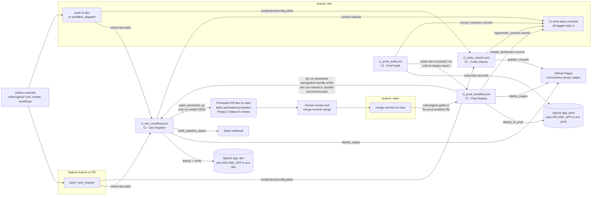
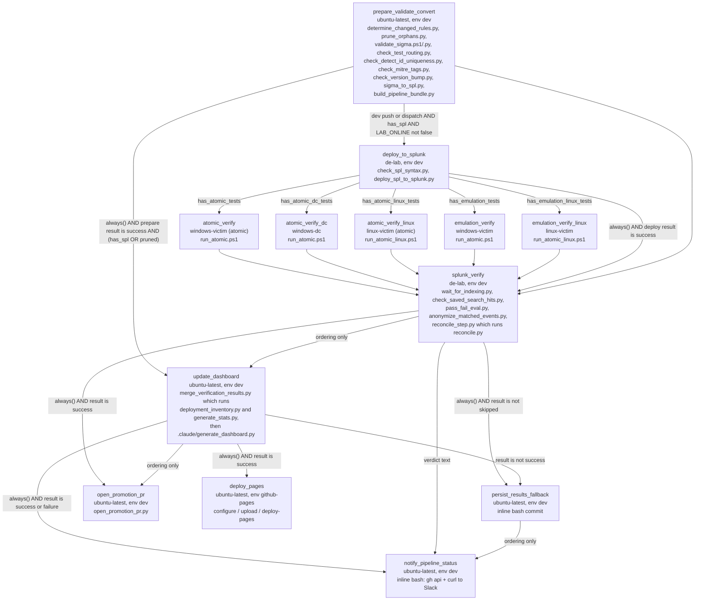
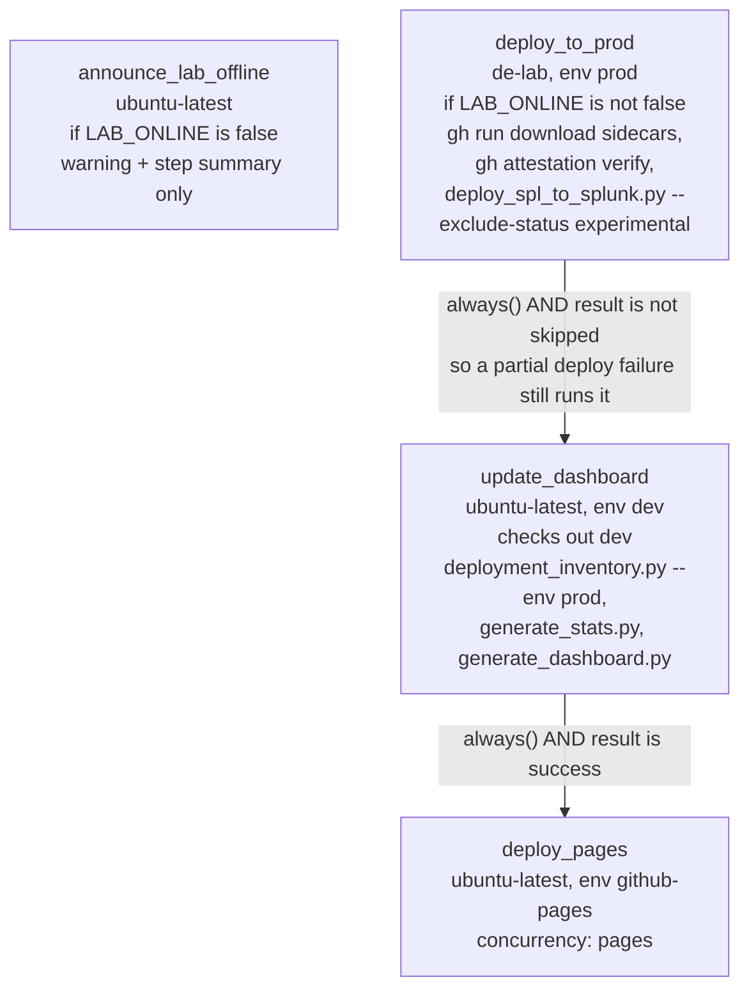
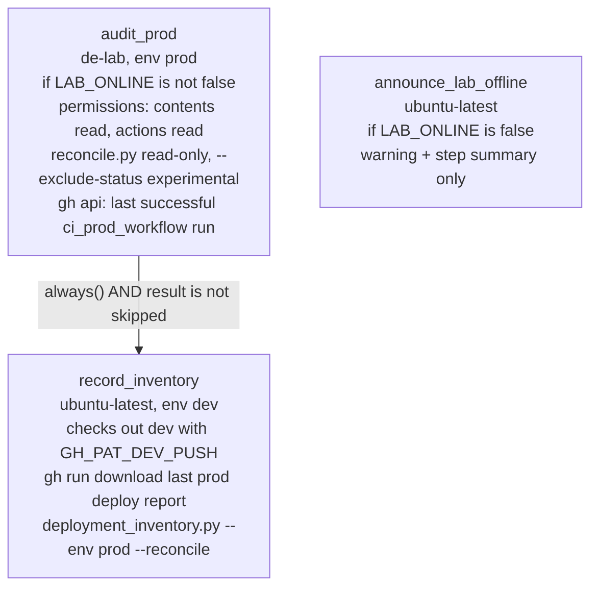
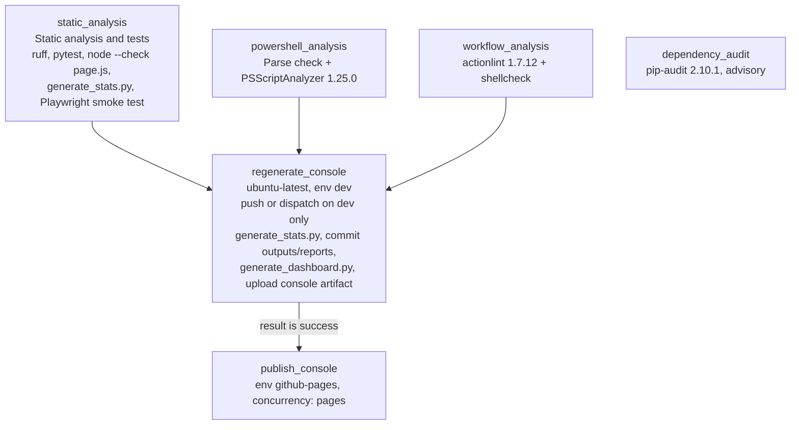
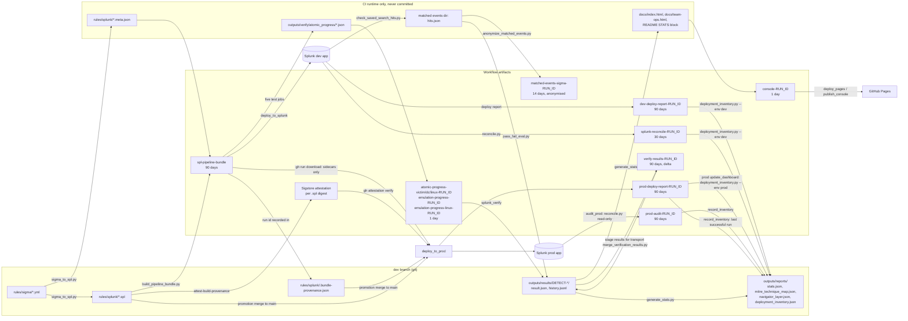

# CI Workflow Topology

The complete map of this repository's GitHub Actions system: every workflow, trigger, job, gate, runner, script, artifact, write-back commit, PR, notification and Pages publish, and how the four workflows connect to each other through branches, PRs and files.

This file only covers wiring. For what each pipeline stage *means* (verdict lifecycle, retirement, the dev/prod app split), read [`pipeline_overview.md`](pipeline_overview.md). For per-file artefact formats, read [`data_flow.md`](data_flow.md). For what each script does internally, read [`scripts_reference.md`](scripts_reference.md). For the CI failure modes behind most of the conditions below, read the repo skill `.claude/skills/pipeline-ci-gotchas/SKILL.md` (cited below as *gotchas §X*).

**How to read the anchors.** `ci_dev_workflow.yml:939` means line 939 of `.github/workflows/ci_dev_workflow.yml`. Every anchor was checked against the YAML on 2026-10-25. Line numbers drift as the files change, so if an anchor looks wrong, search for the job or step name instead. Secret and variable names were also checked that day against the live repository settings with `gh secret list` / `gh variable list`, which shows names only. No values appear anywhere in this document.

---

## 1. The four workflows at a glance

| File | `name:` | Purpose | Triggers | Concurrency group | Jobs |
|---|---|---|---|---|---|
| `ci_dev_workflow.yml` | CI - Dev Pipeline | The detection loop: validate, convert, deploy to the dev Splunk app, attack, verify, write back evidence, publish the console, open the promotion PR | `push` (every branch except `main`, path-filtered), `pull_request` (path-filtered), `workflow_dispatch` (3 inputs) | `detection-pipeline-${{ github.ref }}`, `cancel-in-progress: false` (`:157-159`) | 11 |
| `ci_prod_workflow.yml` | CI - Prod Deploy | Ships the attested `.spl` on `main` to the prod Splunk app, then records it in the inventory and republishes the console | `push` to `main` (path-filtered), `workflow_dispatch` (no inputs) | `detection-pipeline-prod-${{ github.ref }}`, `cancel-in-progress: false` (`:24-26`) | 4 |
| `ci_prod_audit.yml` | CI - Prod Audit | Read-only reconcile of the prod Splunk app against `main`. The result is recorded on `dev` | `workflow_dispatch` only (`:24-25`) | `detection-pipeline-prod-${{ github.ref }}`, `cancel-in-progress: false` (`:27-32`). This is the same lane as the prod deploy. || 3 |
| `ci_code_checks.yml` | CI - Code Checks | The pipeline's own CI: lint, tests, PowerShell and workflow analysis, dependency audit, and the light-path console regenerate and publish | `push` (every branch except `main`, path-filtered), `pull_request` (path-filtered), `workflow_dispatch` | `code-checks-${{ github.ref }}`, **`cancel-in-progress: true`** (`:97-99`) | 6 |

There is also a job-level concurrency group shared across workflows: **`pages`** (`cancel-in-progress: false`). It is declared by three jobs in three files: `ci_dev_workflow.yml:2998-3000` (`deploy_pages`), `ci_prod_workflow.yml:555-557` (`deploy_pages`) and `ci_code_checks.yml:812-814` (`publish_console`). Concurrency groups are repo-wide, so the three Pages publishers queue behind each other instead of racing to publish different snapshots.

**Workflow-level `permissions:`.** Each file sets a narrow default, and individual jobs override it:

- dev: `contents: read` (`:184-185`)
- prod: `contents: read` (`:28-29`)
- audit: `{}`, meaning nothing (`:37`)
- code checks: `contents: read` (`:101-102`)

Job-level `permissions:` *replace* the workflow block rather than merging with it (comment at `ci_dev_workflow.yml:202-209`). Pushes to the protected `dev` branch never use the ambient `GITHUB_TOKEN`. They always go through the `GH_PAT_DEV_PUSH` environment secret.

---

## 2. Diagram 1: how the workflows connect

How the connections work, in order:

1. **Authoring → dev pipeline.** A push to any branch except `main` whose paths match the filter (`ci_dev_workflow.yml:4-43`) starts the dev workflow. Only a push to `dev`, or a manual dispatch on `dev`, goes past validation and conversion: every later job's `if:` begins with `(github.event_name == 'push' || github.event_name == 'workflow_dispatch') && github.ref == 'refs/heads/dev'`. A pull request, or a push to a feature branch, only runs `prepare_validate_convert`, and inside that job only the validation and conversion steps (§5.1).
2. **Dev write-backs do not retrigger anything.** Every commit CI pushes to `dev` carries `[skip ci]` (§8). For example, `ci_code_checks.yml:711-714` explains that without the tag, `regenerate_console` would retrigger itself.
3. **Promotion.** `open_promotion_pr` opens one `dev`→`main` PR, but only when `splunk_verify` succeeded, meaning the overall verdict was PASS (§5.1). A human merges it. Nothing in this repo auto-merges.
4. **Prod is triggered by the merge commit**, and only if the merge touches `rules/sigma/**/*.y{a,}ml` or `.github/workflows/ci_prod_workflow.yml` (`ci_prod_workflow.yml:4-9`). The merge must be a **merge commit**. A squash or rebase merge carries the dev branch's `[skip ci]` strings into `main`'s HEAD commit message, and GitHub then creates no prod run at all. Squash and rebase merging are disabled at the repo level for this reason (gotchas §L). If you need to deploy without a rule change, use `workflow_dispatch` (`ci_prod_workflow.yml:11-22`; gotchas §G).
5. **Prod depends on a specific dev run.** `deploy_to_prod` reads `rules/splunk/.bundle-provenance.json`, which is committed by dev's "Record which run produced this bundle" step. It then downloads that dev run's `spl-pipeline-bundle` artifact for the `.meta.json` sidecars, and verifies each committed `.spl` against that run's Sigstore attestation (§5.2). That artifact is kept for 90 days ("Upload pipeline bundle" step; 7 days before 2026-10-25). If it has expired, the download step fails with an `::error` naming the recovery.
6. **Prod and audit write to `dev`, not `main`.** The inventory and dashboard machinery lives on `dev` (`ci_prod_workflow.yml:404-408`).
7. **The audit workflow** is started by hand. It shares the prod concurrency lane, so it can never read the prod app while a deploy is half-applied (`ci_prod_audit.yml:27-32`). It finds the last successful prod deploy through the Actions API (`:132-163`).

### Which event runs what

| Event / ref | `ci_dev_workflow.yml` | `ci_code_checks.yml` | `ci_prod_workflow.yml` | `ci_prod_audit.yml` |
|---|---|---|---|---|
| push to `dev` (paths match) | Full pipeline. The lab half is gated by `LAB_ONLINE`. | 4 analysis jobs + `regenerate_console` + `publish_console` | — | — |
| push to another branch (paths match) | `prepare_validate_convert` only. No prune, attest, commit or upload of a downstream-consumed bundle, and no deploy. | 4 analysis jobs only | — | — |
| `pull_request` (paths match) | Same as a feature-branch push | 4 analysis jobs only | — | — |
| `workflow_dispatch` on `dev` | Full pipeline. Scope comes from the inputs. | 4 analysis jobs + regenerate + publish | — | — |
| push to `main` (paths match) | — (`branches-ignore: [main]`) | — (`branches-ignore: [main]`) | All 4 jobs | — |
| `workflow_dispatch` (prod) | — | — | All 4 jobs, deploying the full `git ls-files` library | — |
| `workflow_dispatch` (audit) | — | — | — | Both jobs |
| commit with `[skip ci]` in its HEAD message | no run | no run | no run | n/a |

A Dependabot rebase force-push can start `ci_dev_workflow.yml` even when no filtered path changed. That run then dies in seconds at `Checkout`, because runs whose actor is Dependabot get no secrets and the checkout needs `GH_PAT_DEV_PUSH` (gotchas §J).

---

## 3. Triggers in detail

### `ci_dev_workflow.yml`

**`push` (`:4-43`).** `branches-ignore: [ "main" ]`. Path filter:

- `rules/sigma/**/*.yml`, `rules/sigma/**/*.yaml`
- `docs/schemas/sigma_schema.json`
- `scripts/validate/**`, `scripts/convert/**`, `config/**`, `scripts/deploy/**`, `scripts/lib/**`
- `scripts/atomic/**`
- `scripts/verify/**`, `scripts/state/**`
- `.github/workflows/ci_dev_workflow.yml`

`scripts/atomic/**` was the single file `run_atomic.ps1` until 2026-10-25, which left `run_atomic_linux.ps1` out. A runner-script-only edit starts a run, but it converts nothing (`has_rules=false`); the real check for these files is `ci_code_checks.yml`'s PowerShell analysis.

**`pull_request` (`:44-82`).** The same path list, with no branch filter.

**`workflow_dispatch` (`:92-155`).** Three inputs:

| Input | Type | Default | Effect |
|---|---|---|---|
| `scope` (`:104`) | choice: `unverified` \| `all` | `unverified` | `unverified`: only rules with no `result.json`, or whose `result.json` was measured against an older `version:`. Computed by `scripts/state/select_unverified.py`. `all`: every rule. Use `all` after a converter or schema change. |
| `rules` (`:130`) | string | `""` | Comma- or space-separated `detect_id`s. If non-empty, it overrides `scope`. Resolved by `scripts/state/resolve_rule_selection.py`. An unknown id fails the run and lists the valid ones. |
| `retire_orphans` (`:151`) | boolean | `false` | Passes `--apply-removals` to `reconcile.py`, which disables and marks Splunk objects whose rule left the repo. It only takes effect on a `workflow_dispatch` event, never on a push. The double guard is in `scripts/state/reconcile_step.py`. |

**What "scope" means for a push.** `scripts/state/determine_changed_rules.py` decides the `mode`:

- `changed`: the rule files in the before..after diff (`--diff-filter=AMRC`, so deletions are excluded).
- `all`: used when the diff touches any entry of its `REBUILD_ALL_FILES` list: `docs/schemas/sigma_schema.json`, `scripts/validate/validate_sigma.py`, `scripts/validate/validate_sigma.ps1`, `scripts/convert/sigma_to_spl.py`, `scripts/lib/rule_naming.py`, `scripts/convert/backend_config.py`, `config/backends.yml`. Also used when no base diff exists (the first push to a ref).
- `selected` and `unverified`: the two manual-dispatch modes described above.
- `none`: nothing to do.

Outside `all` mode, the script also adds every committed rule that has no `.spl` in `rules/splunk/` yet. This was added after the 2026-09-26 incident where conversion died before the commit; see the comment in `determine_changed_rules.py`. It is why a push touching no rule can still deploy and attack a few rules. The trigger `paths:` list is deliberately broader (globs) than the rebuild-all list (exact files); the reasoning is in the comment at `ci_dev_workflow.yml:11-39` and in gotchas §A.

### `ci_prod_workflow.yml`

**`push` (`:4-9`).** `branches: [ "main" ]`. Paths: `rules/sigma/**/*.yml`, `rules/sigma/**/*.yaml`, `.github/workflows/ci_prod_workflow.yml`. A fix to a deploy script merged to `main` does **not** start a prod run by itself (gotchas §G).

**`workflow_dispatch` (`:22`).** No inputs. The deploy list always comes from `git ls-files`, never from a diff, so a dispatched run redeploys the full library on `main`, minus `status: experimental` rules.

### `ci_prod_audit.yml`

**`workflow_dispatch` only (`:24-25`).** There is no `schedule:`. The header comment (`:19-22`) explains why: the lab is usually off, so a nightly cron would mostly do nothing.

### `ci_code_checks.yml`

**`push` (`:20-50`).** `branches-ignore: [ "main" ]`. Paths:

- `scripts/**`, `tests/**`, `config/**`
- `pyproject.toml`
- `.github/requirements.txt`, `.github/requirements-dev.txt`, `.github/requirements-deploy.txt`
- `.github/workflows/**`
- `.github/PSScriptAnalyzerSettings.psd1`, `.github/actionlint.yaml`
- `.claude/generate_dashboard.py`, `.claude/agent_usage_log.jsonl`

**`pull_request` (`:51-80`).** The same paths.

**`workflow_dispatch` (`:95`).** Forces a console regenerate and Pages publish without running the full dev/Splunk/Atomic pipeline (comment at `:81-94`).

---

## 4. Runners

Every distinct `runs-on:` value, as written in the YAML. The self-hosted labels are also declared in `.github/actionlint.yaml`, so a typo in `runs-on:` is a lint error instead of a job that queues forever.

| `runs-on:` (literal) | Kind | Role | Jobs |
|---|---|---|---|
| `ubuntu-latest` | GitHub-hosted | No lab network access needed. Lint, conversion, write-back commits, PRs, Slack, Pages. | dev: `prepare_validate_convert`, `update_dashboard`, `persist_results_fallback`, `open_promotion_pr`, `notify_pipeline_status`, `deploy_pages` · prod: `announce_lab_offline`, `update_dashboard`, `deploy_pages` · audit: `announce_lab_offline`, `record_inventory` · code checks: all 6 jobs |
| `[ self-hosted, linux, de-lab ]` | Self-hosted Linux, the lab's Splunk-side box | The only runner with a network path to Splunk. Deploys saved searches, queries results and reconciles state. Shared by dev **and** prod, so a job stuck here also blocks prod deploys (comment at `ci_dev_workflow.yml:191-197`). Its system `gh` (2.45.0) is too old for `gh attestation`, so prod installs its own (gotchas §B). | dev: `deploy_to_splunk` (`:942`), `splunk_verify` (`:1694`) · prod: `deploy_to_prod` (`:82`) · audit: `audit_prod` (`:48`) |
| `[ self-hosted, X64, Windows, victim, atomic, windows-victim ]` | Self-hosted Windows victim | Runs Atomic Red Team tests (`Invoke-AtomicRedTeam`) for rules with `custom.testing.runner: windows-victim`, `type: atomic` | dev: `atomic_verify` (`:1134`) |
| `[ self-hosted, X64, Windows, victim, windows-victim ]` | The same Windows victim host | Runs script-emulation tests (`type: emulation`). It has one label fewer (no `atomic`) because emulation never imports the Atomic module. It shares the host with `atomic_verify`, so the two jobs run one after the other, never in parallel. | dev: `emulation_verify` (`:1431`) |
| `[ self-hosted, X64, Windows, dc, windows-dc ]` | Self-hosted Windows domain controller | Runs Atomic tests that need DC context (`runner: windows-dc`) | dev: `atomic_verify_dc` (`:1223`) |
| `[ self-hosted, X64, Linux, victim, atomic, linux-victim ]` | Self-hosted Linux victim (pwsh + Invoke-AtomicRedTeam) | Runs Atomic tests for `runner: linux-victim`. Elevation for atomics that need root happens inside `run_atomic_linux.ps1`, not in the step's `shell:` (comment at `ci_dev_workflow.yml:1360-1386`). As of 2026-10-25 no rule routes here: all 8 `linux-victim` rules (DETECT-2026-0036 to 0043) are `type: emulation`, so this job currently never starts. | dev: `atomic_verify_linux` (`:1311`) |
| `[ self-hosted, X64, Linux, victim, linux-victim ]` | The same Linux victim host | Runs script-emulation tests for `runner: linux-victim` (e.g. nginx access-log rules, where `curl` hits the local nginx) | dev: `emulation_verify_linux` (`:1563`) |

The Linux victim jobs write `Linux` with a capital L, and `de-lab` writes `linux` in lower case. GitHub matches runner labels case-insensitively, so both spellings work.

**Rule `runner` value → job → flag.** `scripts/validate/check_test_routing.py` builds the serviced `(type, runner)` matrix by parsing `ci_dev_workflow.yml` itself. Its `JOB_OUTPUT_FLAGS` table maps each job to the `prepare_validate_convert` output that switches it on:

| Rule `custom.testing` | Job | Output flag |
|---|---|---|
| `type: atomic`, `runner: windows-victim` | `atomic_verify` | `has_atomic_tests` |
| `type: atomic`, `runner: windows-dc` | `atomic_verify_dc` | `has_atomic_dc_tests` |
| `type: atomic`, `runner: linux-victim` | `atomic_verify_linux` | `has_atomic_linux_tests` |
| `type: emulation`, `runner: windows-victim` | `emulation_verify` | `has_emulation_tests` |
| `type: emulation`, `runner: linux-victim` | `emulation_verify_linux` | `has_emulation_linux_tests` |

Each (tester type, runner) pair gets its own job on purpose. A second `run_atomic*.ps1` call inside the same job would wipe the first call's progress markers, and the co-batched rules would come back NOT_VERIFIED (gotchas §A; comment at `ci_dev_workflow.yml:1525-1544`).

**Offline runners.** A job queued for an offline self-hosted runner never starts, so its `timeout-minutes` never begins counting. With `cancel-in-progress: false`, the queued run then blocks the lane for about a day (comment at `ci_dev_workflow.yml:83-91`; gotchas §B). `vars.LAB_ONLINE` exists for this case (§9). It is all-or-nothing: if `LAB_ONLINE` is not `false` but one VM is off, that VM's test job queues and `splunk_verify` waits on it through `needs:`.

---

## 5. Job-by-job topology

### 5.1 `ci_dev_workflow.yml`

#### Diagram 2a: dev job graph

Every test job and `splunk_verify` also requires a `push`/`workflow_dispatch` event on `refs/heads/dev` and `has_spl == 'true'`. So do `update_dashboard`, `notify_pipeline_status` and `deploy_pages`, except that `update_dashboard` (and so the two after it) also runs when `pruned == 'true'`. The diagram leaves these clauses off to stay readable.

#### `prepare_validate_convert`: "Prepare, Validate, Convert" (`:188`)

- **Runner** `ubuntu-latest` (`:190`). **Timeout** 30 (`:200`). **Environment** `dev` (`:201`). It needs `dev` because the checkout uses the environment secret `GH_PAT_DEV_PUSH`.
- **Permissions** (`:210-214`): `contents: write`, `pull-requests: write`, `id-token: write`, `attestations: write`. The last two are for the provenance attestation.
- **Outputs** (`:215-233`): `mode`, `base_sha`, `has_rules`, `has_spl`, `pruned`, `rule_files`, `spl_files`, `has_atomic_tests`, `has_atomic_dc_tests`, `has_atomic_linux_tests`, `has_emulation_tests`, `has_emulation_linux_tests`.

| Step `name:` | Line | `if:` | What it does / script |
|---|---|---|---|
| Checkout | `:236` | — | `fetch-depth: 0`, `token: secrets.GH_PAT_DEV_PUSH` |
| Setup Python | `:242` | — | Python 3.11 |
| Determine changed Sigma files | `:270` | — | `scripts/state/determine_changed_rules.py`. Decides the run's mode and rule set, and writes `base_sha`, `has_base_diff`, `changed_rule_files`, `mode`, `has_rules` and `rule_files`. It may call `resolve_rule_selection.py` or `select_unverified.py`. The dispatch inputs and the four SHAs arrive as environment variables. |
| Cache pip packages | `:295` | `has_rules == 'true'` | `actions/cache`, keyed on `.github/requirements.txt` |
| Install Python deps | `:304` | `has_rules == 'true'` | `pip install -r .github/requirements.txt` (the pinned conversion toolchain) |
| Prune repo artefacts of deleted rules | `:339` | dev push/dispatch only | `scripts/state/prune_orphans.py --apply`. Deletes `rules/splunk/*.spl` and `outputs/results/<detect_id>/` for rules that no longer exist. Deliberately **not** gated on `has_rules`, because a deletion-only push has `has_rules=false` (gotchas §A). It installs its own deps if they are missing. |
| Validate Sigma rules | `:353` | `has_rules` | `scripts/validate/validate_sigma.ps1`, which wraps `validate_sigma.py`: Draft-07 schema validation against `docs/schemas/sigma_schema.json`. A **hard gate**. |
| Check every rule has a job that can run its test | `:391` | `has_rules` | `scripts/validate/check_test_routing.py --workflow …`. Advisory: warns when a rule's `(type, runner)` pair is serviced by no job. Checks every rule. |
| Check detect_id uniqueness | `:414` | `has_rules` | `scripts/validate/check_detect_id_uniqueness.py`. A **hard gate**, over every rule. |
| Check MITRE ATT&CK tags against the technique map | `:439` | `has_rules` | `scripts/validate/check_mitre_tags.py`. Advisory and offline; reads `outputs/reports/mitre_technique_map.json`. |
| Check version bump discipline | `:487` | `has_rules && has_base_diff` | `scripts/validate/check_version_bump.py --base-ref <base_sha>` over `changed_rule_files`. A **hard gate**: if detection, logsource or raw_query changed, `version:` must change too. |
| Convert Sigma rules to Splunk SPL | `:511` | `has_rules` | `scripts/convert/sigma_to_spl.py --outdir rules/splunk <rule_files>`. Writes a `.spl` and a `.meta.json` per rule. Backend choice comes from `config/backends.yml` via `backend_config.py`. |
| Regenerate meta sidecars for unchanged rules | `:552` | `has_rules` | `sigma_to_spl.py --meta-only` over every *other* committed rule. Prod needs every rule's sidecar in one bundle (gotchas §C). Exposes `unchanged_rules`. |
| Build pipeline bundle | `:637` | `has_rules` | `scripts/state/build_pipeline_bundle.py`. Assembles `pipeline_bundle/`: the atomic runners, the deploy scripts, the whole of `scripts/lib/`, the changed rules' `.spl` + `.meta.json`, and the unchanged rules' `.meta.json`. Writes `has_spl` and `spl_files`. |
| Attest SPL provenance | `:668` | dev push/dispatch && `has_spl` | `actions/attest-build-provenance` over `rules/splunk/**/*.spl`. Fail-closed: if it fails, nothing is committed. |
| Record which run produced this bundle | `:686` | dev push/dispatch && `has_spl` | `jq` writes `rules/splunk/.bundle-provenance.json` (`workflow_run_id`, `run_attempt`, `commit_sha`, `artifact_name: spl-pipeline-bundle`) |
| Commit pipeline outputs to dev | `:723` | dev push/dispatch | Stages `rules/splunk` + `outputs/results` with `-A` and un-stages `*.meta.json`. Commits `chore(convert): update SPL outputs and prune deleted-rule artefacts [skip ci]` (`:747`). Up to 3 attempts of `pull --rebase` + push. |
| Detect test types in pipeline bundle | `:774` | `has_spl` | `check_test_routing.py --job-flags <rule_files>`. Writes the five `has_*_tests` flags. |
| Smoke-test the pipeline bundle | `:814` | `has_spl` | `deploy_spl_to_splunk.py --help` from inside the bundle, then imports every bundled `.py` (gotchas §C) |
| Upload pipeline bundle | `:867` | `has_spl` | Artifact **`spl-pipeline-bundle`**, 7 days |
| Warn that the lab is switched off | `:890` | `vars.LAB_ONLINE == 'false'` | `::warning` + a step-summary block |

Order matters here. The commit step runs **before** the test-type detection, the bundle smoke test and the upload. If the bundle turns out broken, the SPL is still committed and attested (comment at `:803-805`).

#### `deploy_to_splunk`: "Deploy to Splunk" (`:914`)

- **needs** `prepare_validate_convert`. **if** (`:939-941`): dev push/dispatch && `has_spl == 'true'` && `vars.LAB_ONLINE != 'false'`. This is the **only** place in the dev workflow where `LAB_ONLINE` is checked; the dependency graph carries the decision the rest of the way.
- **Runner** `[ self-hosted, linux, de-lab ]`. **Timeout** 75. **Environment** `dev`. **Permissions** `contents: read`. No checkout: it works from the bundle only.

| Step | Line | What it does |
|---|---|---|
| Download pipeline bundle | `:961` | `spl-pipeline-bundle` → `pipeline_bundle/` |
| Setup Python / Install deploy deps | `:967`, `:972` | `pip install requests` (unpinned) |
| Validate SPL syntax against Splunk before deploying | `:997` | `pipeline_bundle/scripts/deploy/check_spl_syntax.py <spl_files>`. Calls Splunk's `search/v2/parser` (parse only, nothing dispatched). A **hard gate**. |
| Deploy selected SPL files to Splunk | `:1024` | `pipeline_bundle/scripts/deploy/deploy_spl_to_splunk.py --report outputs/deploy/dev_deploy_report.json <spl_files>`. Creates or updates saved searches in `vars.SPLUNK_APP`, with sharing `app`, read `*`, write `admin,ci_deploy_savedsearches`. Skips only `status: deprecated`; dev passes **no** `--exclude-status`, so experimental rules do reach the lab. |
| Upload dev deploy report | `:1118` | `always()`. Artifact **`dev-deploy-report-<run_id>`**, 90 days. |

#### The five test jobs (`:1127`, `:1216`, `:1295`, `:1424`, `:1545`)

They all share the same shape:

- **needs** `[ prepare_validate_convert, deploy_to_splunk ]`.
- **if**: dev push/dispatch && `has_spl` && their own `has_*_tests` flag. There is **no `always()`**, so GitHub's implicit `success()` applies, and a skipped or failed `deploy_to_splunk` skips them.
- **`continue-on-error: true`** on every one of them.
- **Timeout** 25 for the job, with the attack step capped at 18. The step should time out first, so the job survives long enough to upload its markers.
- **Permissions** `contents: read`. **No environment and no checkout.**

| Job (`name:`) | Steps, in order (literal names) | Runner script + env | Artifact uploaded (`always()`, 1 day) |
|---|---|---|---|
| `atomic_verify` (Atomic Red Team Test) | Mark test-phase start · Download pipeline bundle · Run Atomic Red Team tests embedded in deployed SPL metadata · Upload atomic progress markers | `run_atomic.ps1 -PreflightOnly`, then `run_atomic.ps1`. `ATOMIC_RUNNER=windows-victim`, `ATOMIC_TESTER_TYPE=atomic`, plus `vars.ATOMIC_RED_TEAM_MODULE_PATH`, `vars.ATOMIC_RED_TEAM_PATH`, and `vars.ATOMIC_DISABLE_REALTIME_MONITORING` (falls back to `'true'`). | `atomic-progress-victim-<run_id>` |
| `atomic_verify_dc` (Atomic Red Team Test (DC)) | Mark test-phase start · Download pipeline bundle · Run Atomic Red Team tests on Domain Controller · Upload atomic progress markers | The same two calls, with `ATOMIC_RUNNER=windows-dc` | `atomic-progress-dc-<run_id>` |
| `atomic_verify_linux` (Atomic Red Team Test (Linux)) | Mark test-phase start · Download pipeline bundle · Ensure run_atomic_linux.ps1 is executable · Run Atomic Red Team tests embedded in deployed SPL metadata · Upload atomic progress markers | `run_atomic_linux.ps1 -PreflightOnly`, then `run_atomic_linux.ps1`, under `pwsh`. `ATOMIC_RUNNER=linux-victim`, plus `vars.ATOMIC_RED_TEAM_MODULE_PATH_LINUX` and `vars.ATOMIC_RED_TEAM_PATH_LINUX`. | `atomic-progress-linux-<run_id>` |
| `emulation_verify` (Script Emulation Test) | Mark test-phase start · Download pipeline bundle · Run Script Emulation tests embedded in deployed SPL metadata · Upload emulation progress markers | `run_atomic.ps1` (no preflight). `ATOMIC_RUNNER=windows-victim`, `ATOMIC_TESTER_TYPE=emulation`. | `emulation-progress-<run_id>` |
| `emulation_verify_linux` (Script Emulation Test (Linux)) | Mark test-phase start · Download pipeline bundle · Ensure run_atomic_linux.ps1 is executable · Run Script Emulation tests embedded in deployed SPL metadata · Upload emulation progress markers (Linux) | `run_atomic_linux.ps1` (no preflight). `ATOMIC_RUNNER=linux-victim`, `ATOMIC_TESTER_TYPE=emulation`. Custom commands are run as PowerShell via `Invoke-Expression` (gotchas §A). | `emulation-progress-linux-<run_id>` |

"Mark test-phase start" is always the first step. It writes the job output `started_at` (epoch seconds), and `splunk_verify` anchors its search window on the earliest of these values. Each runner script clears stale `*.json` markers in `outputs/verify/atomic_progress` before its real (non-preflight) run, then writes one marker per `detect_id`.

#### `splunk_verify`: "Splunk Verification" (`:1665`)

- **needs**: `prepare_validate_convert`, `deploy_to_splunk`, and all five test jobs (`:1667`).
- **if** (`:1688-1693`): `always()` && dev push/dispatch && `has_spl` && `prepare_validate_convert.result == 'success'` && **`deploy_to_splunk.result == 'success'`**. The test jobs' results are deliberately not checked (comment at `:1668-1687`).
- **Runner** `[ self-hosted, linux, de-lab ]`. **Timeout** 120. **Environment** `dev`. **Permissions** `contents: read`. The checkout is shallow, with the default token and no PAT; this job no longer pushes.

| Step | Line | `if:` | What it does |
|---|---|---|---|
| Checkout | `:1737` | — | Default token, depth 1 |
| Download pipeline bundle | `:1741` | — | `spl-pipeline-bundle` |
| Download dev deploy report | `:1756` | c-o-e | `dev-deploy-report-<run_id>` → `outputs/deploy` |
| Download atomic progress markers (victim) / (DC) / (Linux) | `:1768`, `:1776`, `:1784` | the matching `has_*` flag; c-o-e | Pooled into `outputs/verify/atomic_progress` |
| Download emulation progress markers / (Linux) | `:1795`, `:1809` | the matching `has_*` flag; c-o-e | The same pool |
| Setup Python / Install deps | `:1829`, `:1835` | `always() && checkout succeeded` | `pip install requests pyyaml` (unpinned). The step id is `deps`. |
| Compute verification time window | `:1845` | — | Earliest `started_at` across the five test jobs, minus 60 s. If none was reported, falls back to `-15m` with a warning. |
| Wait for Splunk indexing | `:1921` | — | `scripts/verify/wait_for_indexing.py --since <earliest> --timeout 180 --interval 10`. Polls the indexes named in the sidecars. If indexing is not confirmed, it warns and exits 0. |
| Query Splunk for matched events | `:1954` | — | `scripts/verify/check_saved_search_hits.py --earliest <epoch> --latest now --output-dir <tmp>`. Dispatches each saved search and writes `hits.json` per rule. |
| Evaluate Pass/Fail | `:1998` | — | `scripts/verify/pass_fail_eval.py --min-pass 1 --max-pass 10 --progress-dir …`. Writes `outputs/results/<detect_id>/result.json` and appends to `history.jsonl`. The exit code is captured as a step output and does not fail the step. |
| Anonymize matched events before upload | `:2046` | `always()` && the matched dir exists | `scripts/verify/anonymize_matched_events.py`. Pseudonymises lab hostnames, domain and accounts. Salt: `secrets.MATCHED_EVENTS_ANON_SALT` (optional). |
| Upload matched events artifact | `:2072` | `always()` && the anon dir exists | **`matched-events-sigma-<run_id>`**, 14 days |
| Reconcile Splunk state against the repo | `:2138` | `always() && deps succeeded`; c-o-e | `scripts/state/reconcile_step.py`, which runs `scripts/state/reconcile.py --rules-dir rules/sigma --json outputs/state/reconcile.json --apply`, plus `--apply-removals` on a dispatch with `retire_orphans` set. `--apply` deletes rename orphans only. |
| Upload reconciliation report | `:2164` | `always()`; c-o-e | **`splunk-reconcile-<run_id>`**, 30 days |
| Stage verification results for transport | `:2236` | `always() && checkout succeeded` | Uses `git status` to find the result files this run touched. Copies `result.json` files and writes the last line of each `history.jsonl` as `history.jsonl.delta` into `outputs/verify/results_upload/results/`. |
| Upload verification results | `:2307` | `always() && staged == 'true'`; c-o-e | **`verify-results-<run_id>`**, 90 days |
| Report verification verdict | `:2317` | — | Exits with `pass_fail_eval.py`'s code, so **the job's `result` is the verdict**: `success` = PASS, `failure` = FAIL. |

"c-o-e" means `continue-on-error: true`.

#### `update_dashboard`: "Update Dashboard & Docs" (`:2328`)

- **needs** `[ prepare_validate_convert, splunk_verify ]`. **if** (`:2388-2392`): `always()` && dev push/dispatch && `prepare_validate_convert.result == 'success'` && (`has_spl == 'true'` || `pruned == 'true'`). `pruned` is set by the prune step when it removed anything, so a deletion-only push still republishes the console. It does not check `splunk_verify` at all, and it does not check `LAB_ONLINE`; `splunk_verify` is listed in `needs:` for ordering only.
- **Runner** `ubuntu-latest`. **Timeout** 15. **Environment** `dev`. **Permissions** `contents: write`. The checkout uses `GH_PAT_DEV_PUSH` with `fetch-depth: 0`, because `generate_stats.py` walks git history for its trend caches (gotchas §H).

| Step | Line | What it does |
|---|---|---|
| Checkout / Setup Python / Install deps | `:2422`, `:2428`, `:2433` | `pip install pyyaml` |
| Download verification results | `:2454` | c-o-e. `verify-results-<run_id>` → `outputs/verify/results_download` |
| Download dev deploy report | `:2471` | c-o-e. → `outputs/deploy` |
| Download reconciliation report | `:2478` | c-o-e. → `outputs/state` |
| Merge verification results, generate stats and commit | `:2508` | `scripts/state/merge_verification_results.py`. Up to 3 attempts, each doing: reset to `origin/dev` → overlay `result.json` files and append the deltas (guarded so the same line is never appended twice) → `scripts/state/deployment_inventory.py --env dev …` (if a report or reconcile file exists) → `scripts/docs/generate_stats.py` → stage **only** `outputs/results/` + `outputs/reports/` → commit `chore(pipeline): verification results and dashboard [skip ci]` → push |
| Generate team-ops dashboard for Pages | `:2536` | `python3 .claude/generate_dashboard.py`. Writes `docs/team-ops.html` and the avatar images. |
| Upload console artifact for Pages | `:2562` | **`console-<run_id>`** = the whole `docs/` tree, 1 day. `docs/index.html` and README's STATS block are regenerated on disk but are **not committed**; they reach Pages only through this artifact. |

#### `persist_results_fallback`: "Persist Verification Results (fallback)" (`:2586`)

- **needs** `[ splunk_verify, update_dashboard ]`. **if** (`:2606-2609`): `always()` && `splunk_verify.result != 'skipped'` && `update_dashboard.result != 'success'`. On a normal run it has zero steps.
- **Runner** `ubuntu-latest`. **Timeout** 10. **Environment** `dev`. **Permissions** `contents: write`.
- **Steps:**
  - Checkout (PAT, shallow).
  - Download verification results (c-o-e, id `fetch`).
  - Commit verification results (`:2651`, `if: steps.fetch.outcome == 'success'`). Inline bash with the same overlay and delta-append logic as above. It commits **only** `outputs/results/` as `chore(verify): persist verification results after dashboard failure [skip ci]` (`:2711`), up to 3 attempts. The dashboard is not regenerated.

#### `open_promotion_pr`: "Open Promotion PR" (`:2725`)

- **needs** `[ splunk_verify, update_dashboard ]`. `update_dashboard` is listed for ordering only, so that `stats.json` is fresh when this job reads it.
- **if** (`:2754-2756`): `always() && needs.splunk_verify.result == 'success'`. **Both parts are load-bearing.** Without `always()`, GitHub ANDs an implicit `success()` onto the condition. That implicit check was observed to come out false, and skip this job, whenever an upstream job had been skipped. The gate also reads the job's `result`, never its `outputs`, because outputs from a job whose own `if:` starts with `always()` did not reliably reach downstream `if:` conditions (run `30154222981`; gotchas §A).
- **Runner** `ubuntu-latest`. **Timeout** 15. **Environment** `dev`. **Permissions** `contents: read`, `pull-requests: write`.
- **Steps:** Checkout (shallow, default token) · Setup Python · **Open promotion PR to main and mark it In review** (`:2802`). That last step runs `scripts/state/open_promotion_pr.py` with `GH_TOKEN=secrets.GH_PAT_DEV_PUSH`, which:
  - stops if a `dev`→`main` PR is already open;
  - otherwise runs `gh pr create --base main --head dev --title "Promote verified detections from dev to main" --label automated-promotion`, with a body built from `stats.json` (fetched from `dev` via the contents API: a stale-rule warning and a per-rule table);
  - then, best-effort, adds the PR to Project #3 and sets its Status to `In review`.

#### `notify_pipeline_status`: "Notify Pipeline Status (Slack)" (`:2816`)

- **needs** `[ splunk_verify, update_dashboard, persist_results_fallback ]`. **if** (`:2844-2847`): `always()` && dev push/dispatch && `update_dashboard.result` is `success` or `failure`.
- **Runner** `ubuntu-latest`. **Timeout** 5. **Environment** `dev`, because `SLACK_WEBHOOK_URL` is a dev environment secret. **Permissions** `contents: read`. That permission is load-bearing: the `gh api` read uses `github.token`.
- **Step** Post pipeline summary to Slack (`:2870`), inline bash:
  - Maps `splunk_verify.result` to PASS, FAIL or SKIPPED.
  - Reads the library counts from `outputs/reports/stats.json` on `dev` via `gh api`.
  - Adds a note if `vars.LAB_ONLINE == 'false'`.
  - POSTs to `secrets.SLACK_WEBHOOK_URL` with `curl`.
  - Always exits 0. A missing webhook or an HTTP error only produces a warning.

#### `deploy_pages`: "Deploy GitHub Pages" (`:2958`)

- **needs** `[update_dashboard]`. **if** (`:2985-2988`): `always()` && dev push/dispatch && `update_dashboard.result == 'success'`.
- **Runner** `ubuntu-latest`. **Timeout** 15. **Permissions** `pages: write`, `id-token: write`. **Concurrency** `pages`. **Environment** `github-pages`.
- **Steps:** Download console artifact (`console-<run_id>` → `docs`) · `actions/configure-pages` · `actions/upload-pages-artifact` (path `docs/`) · `actions/deploy-pages`. The last three are unnamed `uses:` steps. There is no checkout.

### 5.2 `ci_prod_workflow.yml`

#### Diagram 2b: prod job graph

`announce_lab_offline` and `deploy_to_prod` have no `needs:` between them; their `if:` conditions are exact complements of each other.

#### `announce_lab_offline`: "Lab Offline Notice" (`:51`)

- **if** `vars.LAB_ONLINE == 'false'`. **Runner** `ubuntu-latest`. **Timeout** 5.
- **Step:** Say that prod was not updated (a `::warning` + a step summary).
- This job exists because otherwise a lab-off run would be made up entirely of skipped jobs, and would look exactly like a healthy run in the run list.

#### `deploy_to_prod`: "Deploy to Prod Splunk" (`:75`)

- **if** `vars.LAB_ONLINE != 'false'` (`:81`). **Runner** `[ self-hosted, linux, de-lab ]`. **Timeout** 60. **Environment** `prod`. It has no `permissions:` block of its own, so it inherits `contents: read`.

| Step | Line | What it does |
|---|---|---|
| Checkout | `:92` | `fetch-depth: 0`, default token (of `main`) |
| Setup Python | `:97` | 3.11 |
| Install deploy runtime deps | `:106` | `pip install -r .github/requirements-deploy.txt` (only `requests`; gotchas §G) |
| Install a modern gh CLI | `:130` | Pinned gh 2.97.0 with a sha256 check, installed into `$RUNNER_TEMP` and put on `PATH` for this job only (gotchas §B) |
| Download meta sidecars from the attested dev bundle | `:159` | Reads `rules/splunk/.bundle-provenance.json`, then `gh run download <workflow_run_id> --name spl-pipeline-bundle`, and copies only `*.meta.json` into `rules/splunk/`. Fails if the pointer is missing or there are no sidecars. Uses `GH_TOKEN=github.token`. |
| Verify build provenance of every SPL file about to be deployed | `:220` | `gh attestation verify <file> --repo … --signer-workflow <repo>/.github/workflows/ci_dev_workflow.yml` for every `git ls-files rules/splunk/*.spl`, at most 8 in parallel. This is the **sole** integrity gate. Any failure stops the deploy (gotchas §G). |
| Deploy all SPL files to prod Splunk | `:277` | `scripts/deploy/deploy_spl_to_splunk.py --report outputs/deploy/prod_deploy_report.json --exclude-status experimental <all .spl>` (`:335-338`). Exits 2 if any single file failed. |
| Upload prod deploy report | `:343` | `if: always() && steps.deploy.outcome != 'skipped'`. **`prod-deploy-report-<run_id>`**, 90 days. |

Note that the deployed `.spl` content is the copy checked out from git. The bundle supplies only the sidecars (comment at `:181-184`).

#### `update_dashboard`: "Update Dashboard (Prod)" (`:378`)

- **needs** `[deploy_to_prod]`. **if** (`:396`): `always() && needs.deploy_to_prod.result != 'skipped'`.
- **Runner** `ubuntu-latest`. **Timeout** 15. **Environment** `dev`, because the job needs `GH_PAT_DEV_PUSH`. It has no `permissions:` block, so it inherits `contents: read`; the push itself is authenticated by the PAT.

| Step | Line | What it does |
|---|---|---|
| Checkout dev | `:418` | `ref: dev`, PAT, `fetch-depth: 0` |
| Setup Python / Install deps | `:425`, `:430` | `pip install pyyaml` |
| Download prod deploy report | `:443` | c-o-e. `prod-deploy-report-<run_id>` → `outputs/deploy` |
| Update deployment inventory, regenerate dashboard, and commit | `:457` | Up to 3 attempts of: reset to `origin/dev` → `scripts/state/deployment_inventory.py --env prod --deploy-report … --commit <sha> --run-id … --run-url …` (only if the report arrived; never `--reconcile`) → `scripts/docs/generate_stats.py` → `python3 .claude/generate_dashboard.py` → stage `outputs/reports/` → commit `chore(inventory): prod state as deployed [skip ci]` (`:508`) → push to `dev` |
| Upload console artifact for Pages | `:531` | **`console-<run_id>`** (`docs/`), 1 day |

#### `deploy_pages`: "Deploy GitHub Pages (Prod)" (`:538`)

- **needs** `[update_dashboard]`. **if** `always() && needs.update_dashboard.result == 'success'` (`:541`).
- The steps, permissions, concurrency and environment are identical to the dev `deploy_pages`.
- The page it publishes was regenerated from a **`dev` checkout**, not from `main`.

### 5.3 `ci_prod_audit.yml`

#### Diagram 2c: audit job graph

#### `audit_prod`: "Audit Prod Splunk" (`:40`)

- **if** `vars.LAB_ONLINE != 'false'` (`:47`). **Runner** `[ self-hosted, linux, de-lab ]`. **Timeout** 20. **Environment** `prod`. **Permissions** `contents: read`, `actions: read`.
- **Outputs**: `last_sha`, `last_run_id`, `last_run_url`, `last_at`.

| Step | Line | What it does |
|---|---|---|
| Checkout main | `:70` | `ref: main`, `fetch-depth: 0` |
| Setup Python / Install deps | `:76`, `:81` | `pip install -r .github/requirements.txt` (the full toolchain) |
| Reconcile prod Splunk against main | `:88` | `scripts/state/reconcile.py --rules-dir rules/sigma --exclude-status experimental --json outputs/state/prod_reconcile.json`, with **no `--apply`**. The exit code is swallowed and the report text goes to the step summary. |
| Record what prod was last deployed from | `:132` | `gh api …/actions/workflows/ci_prod_workflow.yml/runs?status=success&per_page=1`, written to the job outputs. Non-fatal. |
| Say so if prod drifted | `:165` | `always()`. Reads the counts with `jq`. Missing, renamed, unretired or duplicate objects → `::warning title=Prod drift`. It never fails the run. |
| Upload the prod reconcile report | `:213` | `always()`. **`prod-audit-<run_id>`**, 90 days. |

#### `record_inventory`: "Record Prod State on dev" (`:235`)

- **needs** `audit_prod`. **if** `always() && needs.audit_prod.result != 'skipped'` (`:240`).
- **Runner** `ubuntu-latest`. **Timeout** 10. **Environment** `dev`. **Permissions** `contents: read`; the push uses the PAT.

| Step | Line | What it does |
|---|---|---|
| Checkout dev | `:248` | `ref: dev`, PAT, `fetch-depth: 0` |
| Setup Python | `:257` | — |
| Download the prod reconcile report | `:262` | c-o-e, id `fetch`. `prod-audit-<run_id>` → `outputs/state` |
| Download the last prod deploy report | `:281` | c-o-e. `gh run download <last_run_id> --name prod-deploy-report-<last_run_id>` from the **prod workflow's** run, using the PAT as `GH_TOKEN` |
| Update the deployment inventory | `:306` | `if: steps.fetch.outcome == 'success'`. Up to 3 attempts of: reset to `origin/dev` → `scripts/state/deployment_inventory.py --env prod [--deploy-report …] --reconcile outputs/state/prod_reconcile.json --commit/--run-id/--run-url/--deployed-at <from audit_prod outputs>` → stage `outputs/reports/deployment_inventory.json` → commit `chore(inventory): prod state as audited [skip ci]` (`:352`) → push |

### 5.4 `ci_code_checks.yml`

#### Diagram 2d: code-checks job graph

`dependency_audit` is deliberately **not** in `regenerate_console`'s `needs:` (`:566`). An advisory audit must not hold up a republish.

| Job (`name:`) | Line | Runner / timeout | Steps (literal names) and scripts |
|---|---|---|---|
| `static_analysis` (Static analysis and tests) | `:105` | `ubuntu-latest` / 20 | Checkout (`fetch-depth: 0`) · Setup Python (pip cache) · Install deps (`requirements.txt` + `requirements-dev.txt`) · **Ruff** (`ruff check .`) · **Pytest** (`pytest`, which runs `tests/`) · Setup Node.js (`!cancelled()`) · **JS syntax check (page.js)** (`sed` replaces the `@@TOKEN@@` placeholders, then `node --check`) · **Generate rule browser for smoke test** (`scripts/docs/generate_stats.py`) · Install Playwright (`playwright@1.55.0`, Chromium) · **Rule browser smoke test** (`node scripts/docs/smoke_test_rule_browser.js --docs-dir docs --stats outputs/reports/stats.json`). Every step after Pytest runs with `!cancelled()`, so a ruff or pytest failure does not hide a JS or smoke-test failure. The last two steps also require the generate step to have succeeded. |
| `powershell_analysis` (PowerShell analysis) | `:290` | `ubuntu-latest` / 20 | Checkout · Install PSScriptAnalyzer (1.25.0) · **Parse check** (every `scripts/**/*.ps1` through the PowerShell parser) · **PSScriptAnalyzer** (settings from `.github/PSScriptAnalyzerSettings.psd1`; only Error and ParseError severities fail the job) |
| `workflow_analysis` (Workflow analysis) | `:384` | `ubuntu-latest` / 20 | Checkout · Install actionlint (1.7.12, sha256-checked) · **Verify shellcheck is present** · **Run actionlint** (`actionlint -color`; every shellcheck severity gates) |
| `dependency_audit` (Dependency audit) | `:468` | `ubuntu-latest` / 20 | Checkout · Setup Python · Install pip-audit (2.10.1) · **Audit pinned dependencies** over `.github/requirements.txt`, `requirements-dev.txt` and `requirements-deploy.txt`. Findings → `::warning` + step summary, exit 0. If pip-audit fails to run at all → the job fails (gotchas §E). |
| `regenerate_console` (Regenerate Console) | `:564` | `ubuntu-latest` / 30 | needs the three analysis jobs. if `(push or workflow_dispatch) && ref == dev` (`:570`). Environment `dev`. No `permissions:` block, so `contents: read`; the push uses the PAT. Output `published`. Steps: Checkout (PAT, `fetch-depth: 0`) · Setup Python · Install deps (`requirements.txt`) · **Regenerate and commit if changed** (up to 3 attempts of: reset to `origin/dev` → `generate_stats.py` → `git add outputs/reports/` → commit only if something other than timestamps and SHAs changed (gotchas §H) → `chore(docs): regenerate Console and stats [skip ci]` (`:714`) → push) · **Generate team-ops dashboard for Pages** (`python3 .claude/generate_dashboard.py`) · **Upload console artifact for Pages** (`console-<run_id>`, 1 day) |
| `publish_console` (Publish Console) | `:778` | `ubuntu-latest` / 15 | needs `regenerate_console`. if `needs.regenerate_console.result == 'success'` (`:800`). Permissions `pages: write`, `id-token: write`. Concurrency `pages`. Environment `github-pages`. Steps: Download console artifact · configure-pages · upload-pages-artifact · deploy-pages. |

---

## 6. Job → runner → scripts → secrets/variables

The secret/variable column lists only what each job's steps actually reference. The scope column shows where each name is defined in the repository's settings.

| Workflow · job | Runner | Environment | Scripts invoked | Secrets | Variables |
|---|---|---|---|---|---|
| dev · `prepare_validate_convert` | ubuntu-latest | dev | `determine_changed_rules.py` (→ `resolve_rule_selection.py`, `select_unverified.py`), `prune_orphans.py`, `validate_sigma.ps1`/`validate_sigma.py`, `check_test_routing.py` (×2), `check_detect_id_uniqueness.py`, `check_mitre_tags.py`, `check_version_bump.py`, `sigma_to_spl.py` (×2), `build_pipeline_bundle.py` | `GH_PAT_DEV_PUSH` | `LAB_ONLINE` |
| dev · `deploy_to_splunk` | de-lab | dev | `check_spl_syntax.py`, `deploy_spl_to_splunk.py` (both from the bundle) | `SPLUNK_BASE_URL`, `SPLUNK_USERNAME`, `SPLUNK_PASSWORD` | `LAB_ONLINE` (in `if:`), `SPLUNK_APP`, `SPLUNK_VERIFY_TLS` |
| dev · `atomic_verify` | windows-victim (atomic) | — | `run_atomic.ps1` | — | `ATOMIC_RED_TEAM_MODULE_PATH`, `ATOMIC_RED_TEAM_PATH`, `ATOMIC_DISABLE_REALTIME_MONITORING` |
| dev · `atomic_verify_dc` | windows-dc | — | `run_atomic.ps1` | — | the same three |
| dev · `atomic_verify_linux` | linux-victim (atomic) | — | `run_atomic_linux.ps1` | — | `ATOMIC_RED_TEAM_MODULE_PATH_LINUX`, `ATOMIC_RED_TEAM_PATH_LINUX` |
| dev · `emulation_verify` | windows-victim | — | `run_atomic.ps1` | — | — |
| dev · `emulation_verify_linux` | linux-victim | — | `run_atomic_linux.ps1` | — | — |
| dev · `splunk_verify` | de-lab | dev | `wait_for_indexing.py`, `check_saved_search_hits.py`, `pass_fail_eval.py`, `anonymize_matched_events.py`, `reconcile_step.py` (→ `reconcile.py`) | `SPLUNK_BASE_URL`, `SPLUNK_USERNAME`, `SPLUNK_PASSWORD`, `MATCHED_EVENTS_ANON_SALT` | `SPLUNK_APP`, `SPLUNK_VERIFY_TLS` |
| dev · `update_dashboard` | ubuntu-latest | dev | `merge_verification_results.py` (→ `deployment_inventory.py`, `generate_stats.py`), `.claude/generate_dashboard.py` | `GH_PAT_DEV_PUSH` | — |
| dev · `persist_results_fallback` | ubuntu-latest | dev | inline bash only | `GH_PAT_DEV_PUSH` | — |
| dev · `open_promotion_pr` | ubuntu-latest | dev | `open_promotion_pr.py` | `GH_PAT_DEV_PUSH` (as `GH_TOKEN`) | — |
| dev · `notify_pipeline_status` | ubuntu-latest | dev | inline bash (`gh api`, `curl`) | `SLACK_WEBHOOK_URL`; `github.token` | `LAB_ONLINE` |
| dev · `deploy_pages` | ubuntu-latest | github-pages | — (Pages actions) | OIDC (`id-token`) | — |
| prod · `announce_lab_offline` | ubuntu-latest | — | — | — | `LAB_ONLINE` |
| prod · `deploy_to_prod` | de-lab | prod | `gh run download`, `gh attestation verify`, `deploy_spl_to_splunk.py` | `SPLUNK_BASE_URL`, `SPLUNK_USERNAME`, `SPLUNK_PASSWORD`; `github.token` | `LAB_ONLINE`, `SPLUNK_APP`, `SPLUNK_VERIFY_TLS` |
| prod · `update_dashboard` | ubuntu-latest | dev | `deployment_inventory.py`, `generate_stats.py`, `.claude/generate_dashboard.py` | `GH_PAT_DEV_PUSH` | — |
| prod · `deploy_pages` | ubuntu-latest | github-pages | — | OIDC | — |
| audit · `audit_prod` | de-lab | prod | `reconcile.py`, `gh api` | `SPLUNK_BASE_URL`, `SPLUNK_USERNAME`, `SPLUNK_PASSWORD`; `github.token` | `LAB_ONLINE`, `SPLUNK_APP`, `SPLUNK_VERIFY_TLS` |
| audit · `record_inventory` | ubuntu-latest | dev | `gh run download`, `deployment_inventory.py` | `GH_PAT_DEV_PUSH` | — |
| code · `static_analysis` | ubuntu-latest | — | ruff, pytest (`tests/`), `generate_stats.py`, `smoke_test_rule_browser.js` | — | — |
| code · `powershell_analysis` | ubuntu-latest | — | PSScriptAnalyzer over `scripts/**/*.ps1` | — | — |
| code · `workflow_analysis` | ubuntu-latest | — | actionlint (+ shellcheck) over `.github/workflows/*.yml` | — | — |
| code · `dependency_audit` | ubuntu-latest | — | pip-audit over the three requirements files | — | — |
| code · `regenerate_console` | ubuntu-latest | dev | `generate_stats.py`, `.claude/generate_dashboard.py` | `GH_PAT_DEV_PUSH` | — |
| code · `publish_console` | ubuntu-latest | github-pages | — | OIDC | — |

### Where each name lives (repository settings, checked 2026-10-25)

| Name | Kind | Scope | Referenced by | Notes |
|---|---|---|---|---|
| `GH_PAT_DEV_PUSH` | secret | environment `dev` | every `dev`-branch write-back + the promotion PR | The only credential that can push to protected `dev`. A job that does not declare `environment: dev` sees an empty string (`ci_code_checks.yml:585-589`). |
| `SLACK_WEBHOOK_URL` | secret | environment `dev` | `notify_pipeline_status` | Optional: if missing, the job warns and exits 0 |
| `SPLUNK_BASE_URL`, `SPLUNK_USERNAME`, `SPLUNK_PASSWORD` | secret | repository | every job that talks to Splunk | Shared by dev and prod. One Splunk instance, two apps. |
| `MATCHED_EVENTS_ANON_SALT` | secret | repository | `splunk_verify` | Optional. If unset, the anonymiser falls back to a constant salt. |
| `SPLUNK_APP` | variable | environments `dev` and `prod` (different values) | deploy, verify, reconcile | Must be read only in a step's `env:`, never in a job-level `if:` (gotchas §B) |
| `SPLUNK_VERIFY_TLS` | variable | repository | the same five places | Empty → verify TLS (`env_bool` default `True`; gotchas §F) |
| `LAB_ONLINE` | variable | repository | dev `deploy_to_splunk`, the warning step and the Slack job; prod `announce_lab_offline`/`deploy_to_prod`; audit `announce_lab_offline`/`audit_prod` | Only the literal string `'false'` disables anything (§9) |
| `ATOMIC_RED_TEAM_MODULE_PATH_LINUX`, `ATOMIC_RED_TEAM_PATH_LINUX` | variable | repository | `atomic_verify_linux` | — |
| `ATOMIC_RED_TEAM_MODULE_PATH`, `ATOMIC_RED_TEAM_PATH`, `ATOMIC_DISABLE_REALTIME_MONITORING` | variable | **not set anywhere** | `atomic_verify`, `atomic_verify_dc` | They resolve to empty, so the fallbacks apply: `run_atomic.ps1:7` defaults to the Invoke-AtomicRedTeam 2.3.0 module path, `:9` uses `""` for the atomics path, and the workflow's own `|| 'true'` disables Defender real-time monitoring during the test. |
| `github.token` | built-in | per job | `gh` calls in prod, the audit and Slack | Scoped by the job's `permissions:` |

The settings also hold two **unreferenced leftovers**: a repository *secret* named `SPLUNK_VERIFY_TLS`, and an environment *secret* named `SPLUNK_APP` in both `dev` and `prod`. These date from before both were migrated to variables (comment at `ci_dev_workflow.yml:1074-1085`). No workflow reads them.

---

## 7. Diagram 3: artefact and state flow

### Artifacts: producer → consumer

| Artifact name | Producer (workflow · job · step) | Consumers | Retention | Contents |
|---|---|---|---|---|
| `spl-pipeline-bundle` | dev · `prepare_validate_convert` · Upload pipeline bundle (`:867`) | dev: `deploy_to_splunk`, the 5 test jobs, `splunk_verify` · **prod: `deploy_to_prod` (a different workflow, a later run, via `gh run download`)** | 90 days | `pipeline_bundle/`: the atomic runners, the deploy scripts, `scripts/lib/`, changed rules' `.spl` + `.meta.json`, and every other rule's `.meta.json` |
| `dev-deploy-report-<run_id>` | dev · `deploy_to_splunk` (`:1118`) | `splunk_verify` (downloaded, not read), `update_dashboard` (→ inventory) | 90 days | per-rule created/updated/skipped/failed |
| `atomic-progress-victim-<run_id>` / `-dc-` / `-linux-` | the matching atomic job | `splunk_verify` → `pass_fail_eval.py` NOT_VERIFIED gate | 1 day | one marker per `detect_id` |
| `emulation-progress-<run_id>` / `emulation-progress-linux-<run_id>` | the matching emulation job | `splunk_verify` | 1 day | the same marker format |
| `matched-events-sigma-<run_id>` | dev · `splunk_verify` (`:2072`) | humans only (debugging) | 14 days | anonymised `hits.json` |
| `splunk-reconcile-<run_id>` | dev · `splunk_verify` (`:2164`) | `update_dashboard` (→ inventory) | 30 days | `reconcile.json` |
| `verify-results-<run_id>` | dev · `splunk_verify` (`:2307`) | `update_dashboard`, `persist_results_fallback` | 90 days | changed `result.json` files + `history.jsonl.delta` |
| `console-<run_id>` | dev · `update_dashboard` (`:2562`); prod · `update_dashboard` (`:531`); code · `regenerate_console` (`:771`) | the `deploy_pages` / `publish_console` job of the same run | 1 day | the whole `docs/` tree |
| `prod-deploy-report-<run_id>` | prod · `deploy_to_prod` (`:343`) | prod · `update_dashboard` (same run); **audit · `record_inventory` (a later run, via `gh run download`)** | 90 days | per-rule outcomes |
| `prod-audit-<run_id>` | audit · `audit_prod` (`:213`) | audit · `record_inventory` | 90 days | `prod_reconcile.json` |
| `github-pages` | the `actions/upload-pages-artifact` step in each Pages job | `actions/deploy-pages` | platform default | Pages payload. Re-running a job within a run that has already uploaded it fails the deploy (gotchas, the re-run entry under §K). |
| Sigstore build-provenance attestation | dev · `prepare_validate_convert` · Attest SPL provenance (`:668`) | prod · `deploy_to_prod` · `gh attestation verify` | GitHub attestation store | one multi-subject statement covering every `.spl` on disk in that run |

**Two cross-workflow artifact hand-offs** have timing limits:

- **Prod depends on a dev artifact that expires after 90 days** (7 until 2026-10-25; prod run `40198040696` failed on exactly this). If the pointer's run is older than that, the sidecar download fails with an `::error` that says how to recover, and the prod deploy stops.
- **The audit depends on a prod artifact that expires after 90 days.** If it has expired, the inventory keeps prod's deploy metadata without a per-rule map.

---

## 8. Commits CI writes back

No workflow ever pushes to `main`. All write-backs go to `dev`, through `GH_PAT_DEV_PUSH`, as `github-actions[bot]`, with `[skip ci]` in the message.

| Workflow · job · step | Commit message | Paths staged | Retry |
|---|---|---|---|
| dev · `prepare_validate_convert` · Commit pipeline outputs to dev (`:723`) | `chore(convert): update SPL outputs and prune deleted-rule artefacts [skip ci]` | `rules/splunk` + `outputs/results` (`-A`, including deletions), minus `*.meta.json`; includes `.bundle-provenance.json` | 3 × `pull --rebase` + push |
| dev · `update_dashboard` · Merge verification results, generate stats and commit (`:2508`) | `chore(pipeline): verification results and dashboard [skip ci]` (`merge_verification_results.py` `COMMIT_MESSAGE`) | `outputs/results/`, `outputs/reports/` | 3 × reset to `origin/dev` + redo + push |
| dev · `persist_results_fallback` · Commit verification results (`:2651`) | `chore(verify): persist verification results after dashboard failure [skip ci]` | `outputs/results/` | 3 × reset + push |
| prod · `update_dashboard` · Update deployment inventory, regenerate dashboard, and commit (`:457`) | `chore(inventory): prod state as deployed [skip ci]` | `outputs/reports/` | 3 × reset + push |
| audit · `record_inventory` · Update the deployment inventory (`:306`) | `chore(inventory): prod state as audited [skip ci]` | `outputs/reports/deployment_inventory.json` | 3 × reset + push |
| code · `regenerate_console` · Regenerate and commit if changed (`:627`) | `chore(docs): regenerate Console and stats [skip ci]` | `outputs/reports/` | 3 × reset + push |

**What is never committed:**

- `rules/splunk/*.meta.json` (explicitly un-staged).
- `docs/index.html`, `docs/team-ops.html`, and README's STATS block. These are regenerated on every run but only ever travel as the `console-<run_id>` artifact (feature-and-process-audit item 4.4).
- Everything under `outputs/deploy/`, `outputs/state/` and `outputs/verify/`.

Because the README STATS block is no longer refreshed on `dev`, the committed copy can lag behind `stats.json`.

**The pull request CI opens.** There is exactly one: the dev→main promotion PR from `open_promotion_pr` (§5.1), labelled `automated-promotion`, at most one open at a time. Once it is merged, Project #3's own UI-configured workflow moves the item to `Auto-merged`. No YAML in this repo is involved in that step.

**The notification CI sends.** There is exactly one: the Slack post from `notify_pipeline_status`, in the dev workflow only. The prod and audit workflows report through `::warning` annotations and step summaries.

**Pages publishing.** Three jobs publish: dev `deploy_pages`, prod `deploy_pages`, and code-checks `publish_console`. All three publish a `docs/` tree regenerated from a **`dev`** checkout, and all three share the `pages` concurrency group.

---

## 9. Failure and skip semantics

The pipeline's worst failure is not a red X. It is a green run that did less than it appears to have done (gotchas §A). This section lists every condition under which jobs skip, and whether that skip is visible.

### Rules that hold everywhere

- **A job with a `needs:` but no status function in its `if:`** gets an implicit `success()` ANDed onto the condition. It skips if any job in its `needs:` failed, was skipped or was cancelled. This applies to the five test jobs, `deploy_to_splunk`, `regenerate_console`, and every `needs:` job in the audit and prod workflows that lacks `always()`.
- **`always()` + an explicit `needs.X.result` check** is the repo's pattern for any job that has to run after a skipped or failed upstream job. Used by: `splunk_verify`, `update_dashboard` (dev and prod), `persist_results_fallback`, `open_promotion_pr`, `notify_pipeline_status`, both `deploy_pages`, and `record_inventory`.
- **Read `needs.X.result`, never `needs.X.outputs`, in an `if:`** when job X's own `if:` starts with `always()` (gotchas §A).
- **Environment-scoped values (`SPLUNK_APP`, `GH_PAT_DEV_PUSH`, `SLACK_WEBHOOK_URL`) are empty inside a job-level `if:`.** The environment resolves after the `if:` is evaluated. `LAB_ONLINE` works in a job-level `if:` only because it is a repository variable (gotchas §B).
- **`continue-on-error: true`** is used on the five test jobs (job level), on every artifact download that may legitimately find nothing, on the reconcile step, and on the reconcile and verify-results uploads. A step with continue-on-error still shows as failed in the UI; `dependency_audit` avoids that by translating exit codes instead (gotchas §E).
- **`[skip ci]`, or any other skip string, anywhere in a push's HEAD commit message** means no run is created at all, so no in-workflow guard can report anything (gotchas §L).

### `ci_dev_workflow.yml`

| Condition | What runs | What skips | How visible |
|---|---|---|---|
| `pull_request`, or a push to a non-`dev` branch | `prepare_validate_convert`, validation and conversion steps only | prune, attest, provenance pointer, commit; every other job | Visible: the jobs show as skipped. This is by design. |
| No rule changed, no rebuild-all trigger, and no unconverted rule (`has_rules=false`, `mode=none`). Examples: a `scripts/verify/**`-only edit, or a **deletion-only** push. | `prepare_validate_convert` (determine, prune, commit); on a deletion-only push also `update_dashboard`, `deploy_pages` and `notify_pipeline_status`, via `pruned == 'true'` | everything else downstream | Green, by design. A `scripts/verify/**`-only edit also matches `ci_code_checks.yml`, whose `regenerate_console`/`publish_console` republish the console. |
| `vars.LAB_ONLINE == 'false'` | `prepare_validate_convert` (+ the "Warn that the lab is switched off" step), `update_dashboard`, `deploy_pages`, `notify_pipeline_status` (verdict `SKIPPED`) | `deploy_to_splunk` → five test jobs (implicit `success()`) → `splunk_verify` (needs deploy `success`) → `open_promotion_pr`, `persist_results_fallback` | Visible: a `::warning`, a step-summary block and a Slack note |
| `LAB_ONLINE` is not `false`, but a required runner VM is off | jobs queue; `splunk_verify` waits on them through `needs:` | — | **Hangs.** A queued job's `timeout-minutes` never starts. The dev lane is blocked for about a day (`cancel-in-progress: false`; gotchas §B). |
| A validation hard gate fails (schema, detect_id uniqueness, version bump), or conversion fails | — | the rest of `prepare_validate_convert`, **including the commit**; every downstream job, since `update_dashboard` needs `prepare_validate_convert.result == 'success'` | Red X. A conversion failure can be caused by an unpinned transitive dependency rather than by rule content (gotchas §M). |
| Attest SPL provenance fails | — | the commit and everything after it | Red X. Nothing is committed unattested (fail-closed). |
| The commit succeeds but the bundle smoke test (or a later step in the job) fails | the SPL is already on `dev`, committed and attested | every downstream job, including `update_dashboard` | Red X. `dev` now holds SPL that was never deployed. A later push or an `unverified` dispatch picks it up. |
| `check_spl_syntax.py` or the deploy itself fails | `update_dashboard`, `deploy_pages`, `notify_pipeline_status` (verdict `SKIPPED`) | test jobs, `splunk_verify`, `open_promotion_pr`, `persist_results_fallback` | Red X on `deploy_to_splunk`. The Slack verdict says SKIPPED, not FAIL. |
| A test job fails or times out (`continue-on-error`) | `splunk_verify` and everything after | — | The job shows a failure annotation but the run continues. Rules whose marker never reached `completed` get NOT_VERIFIED, not FAIL. |
| A rule's `(type, runner)` pair is serviced by no job | the rule is deployed; no test job claims it | its test | **Advisory warning only** from `check_test_routing.py` (gotchas §A) |
| `splunk_verify` verdict FAIL (or NOT_VERIFIED) | `update_dashboard`, `deploy_pages`, `notify_pipeline_status` (FAIL) | `open_promotion_pr` | Red X on `splunk_verify` + Slack. No promotion. |
| `update_dashboard` fails (e.g. 3 failed pushes) | `persist_results_fallback` (commits raw `outputs/results/`), `notify_pipeline_status` | `deploy_pages` | Red X + a `::warning` from the fallback. The console is not updated. `open_promotion_pr` still runs if the verdict passed; it reads whatever `stats.json` is on `dev`. |
| The run is cancelled by hand between `splunk_verify` and `update_dashboard` | — | the fallback too (`always()` does not survive cancellation) | Residual risk: the evidence exists only as the 90-day `verify-results` artifact (comment at `:2583-2585`) |
| Re-running failed jobs after `deploy_pages` already ran in that run | — | — | `deploy_pages` fails with "Multiple artifacts named github-pages". Start a fresh run instead (gotchas, the re-run entry under §K). |
| Actor is `dependabot[bot]` | — | — | Fails in seconds at `Checkout`, because there is no access to `GH_PAT_DEV_PUSH` (gotchas §J) |

### `ci_prod_workflow.yml`

| Condition | What runs | What skips | How visible |
|---|---|---|---|
| Promotion merged by squash or rebase (blocked at repo level since 2026-09-09) | nothing: no run is created | everything | **Silent.** No run appears at all (gotchas §L). Recover with `workflow_dispatch`. |
| A non-rule change (e.g. a deploy script fix) merged to `main` | nothing | everything | **Silent.** prod keeps running the old deploy path until a rule change or a dispatch (gotchas §G) |
| `LAB_ONLINE == 'false'` | `announce_lab_offline` | `deploy_to_prod` → `update_dashboard` (result `skipped`) → `deploy_pages` | Visible: a `::warning` + step summary |
| Provenance pointer missing, sidecar artifact expired, or an attestation fails | — | the deploy step, and the report upload (`steps.deploy.outcome` is `skipped`) | Red X. `update_dashboard` **still runs** (the job result is `failure`, not `skipped`), finds no report, regenerates the dashboard, and commits only if `outputs/reports/` changed. `deploy_pages` follows if it succeeded. |
| Partial deploy failure (some rules failed, exit 2) | report upload, `update_dashboard` (folds in the successes), `deploy_pages` | — | Red X on `deploy_to_prod`. The dashboard shows what actually landed. |
| `update_dashboard` fails | — | `deploy_pages` | Red X |

### `ci_prod_audit.yml`

| Condition | What runs | What skips | How visible |
|---|---|---|---|
| `LAB_ONLINE == 'false'` | `announce_lab_offline` | `audit_prod` → `record_inventory` | Visible: a `::warning` + step summary, same as the prod workflow (added 2026-10-25) |
| Drift found | both jobs | — | Visible: `::warning title=Prod drift`. The run stays green on purpose. |
| `reconcile.py` errors before writing its JSON | the drift step finds no JSON ("No reconcile output to read") | `record_inventory`'s update step (artifact download fails → `steps.fetch.outcome != 'success'`) | Weak: the exit code is swallowed, so the run looks green apart from the reconcile text in the step summary |
| No successful prod run found, or its deploy report has expired | inventory update without a per-rule map | — | `::warning` |

### `ci_code_checks.yml`

| Condition | What runs | What skips | How visible |
|---|---|---|---|
| Any analysis job fails (static, PowerShell, workflow) | the other analysis jobs (they run in parallel) | `regenerate_console` → `publish_console` | Red X |
| `dependency_audit` finds CVEs | everything | — | `::warning` only (advisory). It does not block the republish. |
| PR, or a push to a non-`dev` branch | the 4 analysis jobs | `regenerate_console`, `publish_console` | By design |
| Only timestamps or SHAs changed in the regenerated output | `regenerate_console` (no commit, `published=false`), `publish_console` | the commit | By design: Pages still republishes |
| A newer push to the same ref | the new run | the in-flight older run is **cancelled** (`cancel-in-progress: true`), including a pending publish | Shows as "cancelled" |

### `LAB_ONLINE` polarity

Every check is written `!= 'false'` (run) or `== 'false'` (skip or announce), never `== 'true'`. An unset or misspelled variable therefore fails towards *running*, which is the visible outcome, rather than towards silently never deploying (gotchas §B).

---

## 10. Comments in the YAML that no longer match the YAML

These are small mismatches found while tracing the files for this document. None of them changes behaviour; each is a comment that now says something the code no longer does.

None open. Those found were corrected 2026-10-25: the `ci_prod_audit.yml` nightly-schedule wording, `ci_code_checks.yml`'s `git log --follow` mention, and both workflows' `docs/assets/team-ops/avatars/` mentions.

---

## 11. Gotchas cross-reference

| Topology feature | Why it is shaped this way | Skill section |
|---|---|---|
| Prune runs ungated by `has_rules` | `--diff-filter=AMRC` drops deletions | §A |
| Explicit `REBUILD_ALL_FILES` list vs globbed `paths:` | A wrong rebuild trigger costs a full lab attack run | §A |
| `always()` + `.result` on `open_promotion_pr` and friends | Implicit `success()`; outputs that don't propagate | §A |
| Dashboard and Pages decoupled from `splunk_verify` | `LAB_ONLINE=false` used to stop the console updating | §A |
| One job per (tester type, runner) | A second runner call wipes the markers | §A |
| `LAB_ONLINE` repo variable, `!=` polarity | Offline runners queue indefinitely | §B |
| `SPLUNK_APP` read only in a step's `env:` | Environment-scoped vars are empty in a job `if:` | §B |
| Prod installs its own `gh` | de-lab's gh 2.45.0 has no `attestation` subcommand | §B |
| Meta sidecars for all rules in every bundle; `scripts/lib` copied wholesale; bundle smoke test | Prod deploy died on missing sidecars (run 31314423690); `ModuleNotFoundError` (run #67) | §C |
| Results travel as an artifact, one write-back commit, plus a fallback job | Commit storm, no transport channel | §D |
| `if cmd; then` exit capture; exit-code translation in pip-audit | Bash `-e` always on; continue-on-error still shows red | §E |
| `SPLUNK_VERIFY_TLS` / `SPLUNK_APP` as `vars` | Secret redaction gagged the TLS warning | §F |
| Attestation is prod's sole gate; prod `paths:` covers rules only | No re-conversion in prod; non-rule fixes stay dormant | §G |
| `fetch-depth: 0` wherever `generate_stats.py` runs; normalise-then-diff | Trend backfill; commit storm vs swallowed changes | §H |
| Merge-commit-only promotion; `--exclude-status experimental` in prod | Squash merge suppressed prod; experimental rules reached prod | §L |
| Dependabot runs fail at Checkout | No secrets for Dependabot runs | §J |
| Pinned transitive deps | `pyparsing` 3.3.3 broke conversion | §M |
